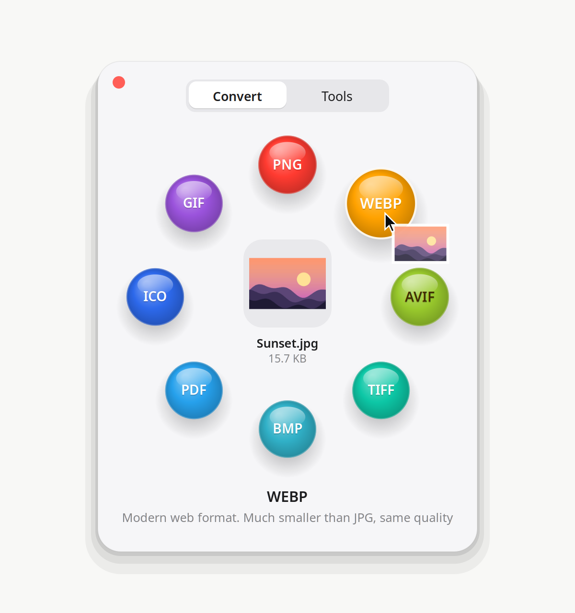
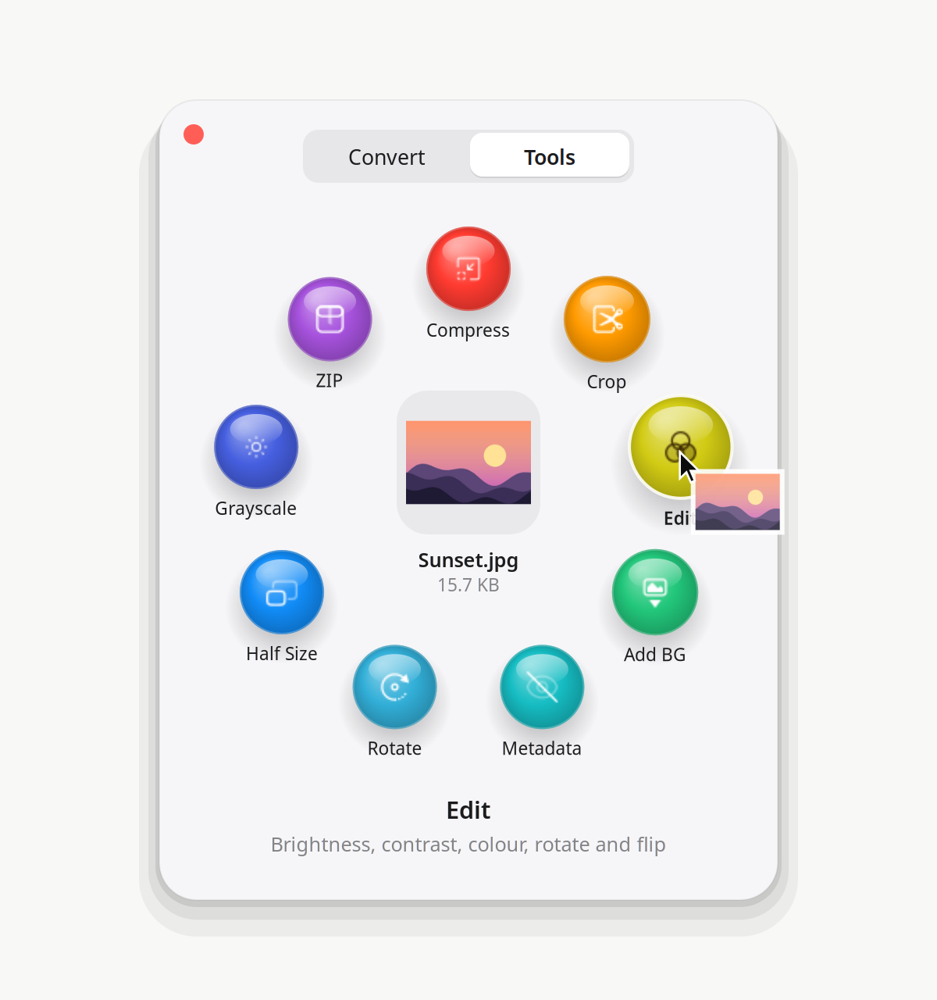
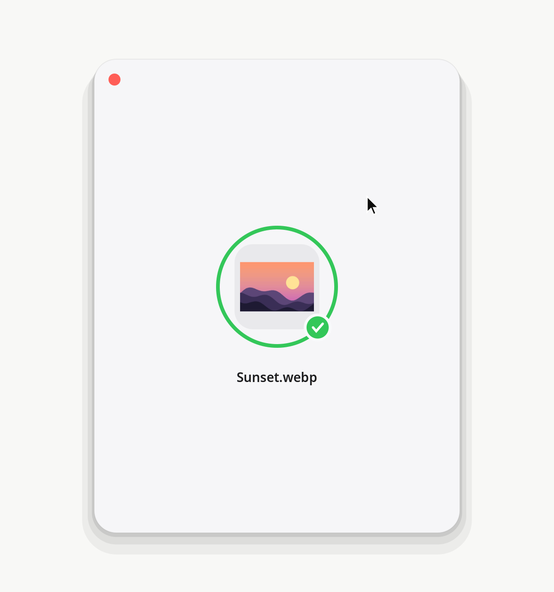
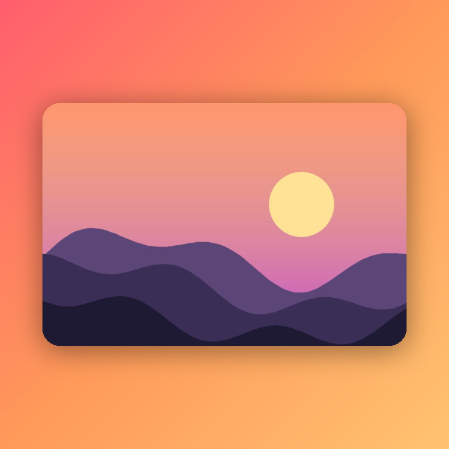

<div align="center">


# orbit

**Drag. Shift. Done.**<br>
Convert and edit any file on Ubuntu with one gesture.

[Website](https://jsticks779.github.io/orbit/) · [Install](#install) · [How it works](#how-it-works) · [Formats](#formats)


</div>

## How it works

Start dragging any file, keep holding, and tap <kbd>Shift</kbd>. A small card opens under your pointer
with everything you can do to that file. Drop it on a bubble and the new file appears **right next to
the original**. Your original is never touched.

| 1. Drag and tap Shift | 2. Pick a bubble | 3. Drop. Done. |
|:---:|:---:|:---:|
|  |  |  |
| The card opens under your pointer. | Bubbles grow as you get close. A one-line hint explains each one. Tap Shift again for Tools. | Real progress, a soft chime, and the card closes itself. |

## Formats

Orbit only shows what fits the file you're holding, and hides anything your system can't do.

| Drop a… | Convert to | Tools |
|---|---|---|
| **Image** | JPG · PNG · WEBP · AVIF · HEIC · TIFF · BMP · GIF · ICO · PDF | Compress · Crop · Edit · Add BG · Metadata · Rotate · Half Size · Grayscale |
| **PDF** | JPG · PNG · TXT · DOCX | Compress · Split Pages · Rotate · Extract Images |
| **Word / Office** | PDF · DOCX · ODT · TXT | |
| **Video** | MP4 · WEBM · MOV · MKV · GIF · MP3 | Trim · Compress · Mute · First Frame |
| **Audio** | MP3 · WAV · OGG · FLAC · M4A · OPUS | Normalize |
| **Several files** | Images → One PDF · PDFs → Merge | ZIP |

## Editors

Some tools need a choice or two, so Orbit opens a tiny editor with a live preview.
These examples were made by Orbit's own code (`tools/render_examples.py`).

| Crop | Edit | Add BG |
|:---:|:---:|:---:|
|  |  |  |
| Handles, 1:1 · 16:9 · 9:16 · 4:3 · 3:4, exact pixels | Brightness, contrast, saturation, warmth, sharpness, rotate, flip | Gradients or colours, padding, corners, shadow, ratio |

**Trim** (video): start and end with a live frame preview, 0.5x to 2x speed, remove sound.

## Install

Ubuntu 24.04 or newer:

```bash
git clone https://github.com/jsticks779/orbit.git
cd orbit
./setup.sh
```

Then **log out and back in once**. That turns on the drag + Shift permission and the small GNOME Shell
helper that opens the card under your pointer (Wayland apps can't position their own windows).
Orbit then starts with every session. Details and troubleshooting: [SETUP.md](SETUP.md).

## Other ways in

```bash
orbit ring photo.png              # open the card for a file and click a bubble
orbit list report.pdf             # what can I do with this file?
orbit run pdf.to_docx report.pdf  # do it from a terminal or script
orbit doctor                      # check what's installed
```

In Files: right-click → **Scripts → Orbit**. Set `ORBIT_SOUNDS=0` to turn the sounds off.

## Privacy

Everything runs on your computer. No network, no accounts, no telemetry. To see the gesture, Orbit
reacts to three input events only (button down, button up, Shift down) and records nothing.
See [SECURITY.md](SECURITY.md).

## Roadmap

- [ ] Remove background (on-device)
- [ ] OCR: scanned PDF or image → text
- [ ] Custom actions from a config file
- [ ] Settings window (quality, output folder, trigger key)
- [ ] Flatpak and .deb packages
- [ ] KDE Plasma

## Contributing

A new file action is about 10 lines of Python. See [CONTRIBUTING.md](CONTRIBUTING.md) and
[ARCHITECTURE.md](ARCHITECTURE.md). The demo video and screenshots are rendered from the real UI code
with `tools/render_demo.py`, so they always match the app.

## License

[MIT](LICENSE). Orby and the Orbit icon are part of this project and share its license.
