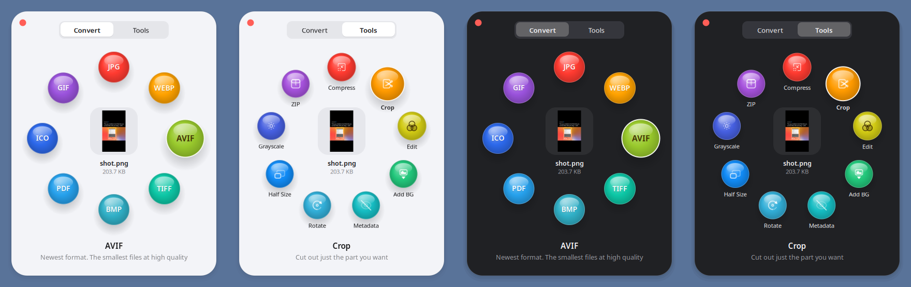
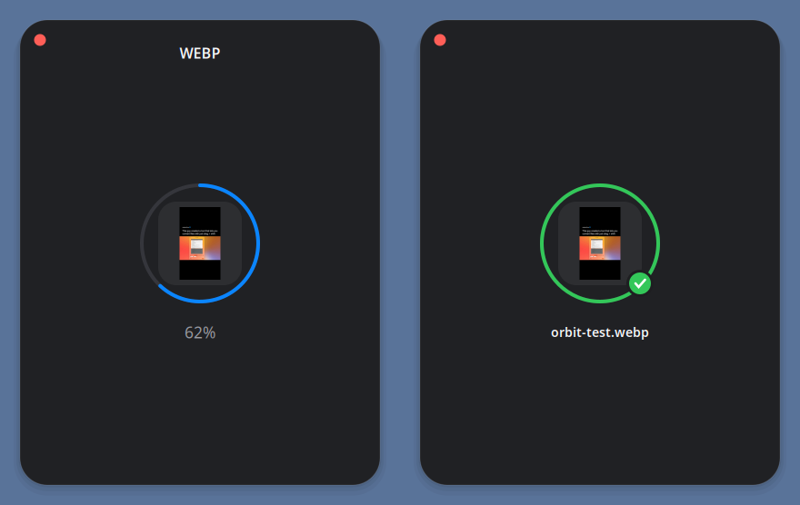

<div align="center">


# Orbit

**Convert and edit any file with a drag + Shift.**
Drag a file, tap <kbd>Shift</kbd>, drop it on a slice. Done.



</div>

## What it does

Start dragging a file in Files (or anywhere), keep the mouse held, and tap **Shift**.
A ring opens under your cursor with everything you can do to that file.
Drop it on a slice and the new file appears right next to the original. Your original is never touched.

Tap **Shift** again (or rest on the centre) to flip to the **Tools** page.
Not sure what **AVIF** or **Metadata** means? Hover a slice and a one-line explanation appears under the ring.

After you drop, the card shows real progress (live from ffmpeg for video, page by page for PDFs),
a ✓ with the new file's name, and then gets out of your way.



| Drop a… | Convert to | Tools |
|---|---|---|
| **Image** | JPG · PNG · WEBP · AVIF · HEIC · TIFF · BMP · PDF · ICO · GIF | Compress · Crop · **Edit** · Add BG · Metadata · Rotate · Half Size · Grayscale |
| **PDF** | JPG · PNG · TXT · DOCX | Compress · Split Pages · Rotate · Extract Images |
| **Word / Office** | PDF · DOCX · ODT · TXT | |
| **Video** | MP4 · WEBM · MOV · MKV · GIF · MP3 | **Trim** · Compress · Mute · First Frame |
| **Audio** | MP3 · WAV · OGG · FLAC · M4A · OPUS | Normalize |
| **Several files** | Images → One PDF · PDFs → Merge | ZIP (any files) |

Small editors open for the tools that need choices:
- **Crop**: drag handles, aspect presets (1:1, 16:9, 9:16, 4:3, 3:4), exact pixel size
- **Edit**: brightness, contrast, saturation, warmth, sharpness, rotate and flip
- **Add BG**: gradients or colours, padding, rounded corners, shadow, ratio
- **Trim** (video): start and end with live frame preview, speed 0.5x to 2x, remove sound

Results are always saved **next to the original**, wherever it is.

## Install (Ubuntu 24.04+)

```bash
git clone https://github.com/jsticks779/orbit.git
cd orbit
./setup.sh
```

Log out and back in once. That applies the drag + Shift permission and turns on the small
GNOME Shell helper that opens the card under your pointer (Wayland apps can't position their
own windows). Orbit then starts with your session.
Full details, other ways in and troubleshooting: **[SETUP.md](SETUP.md)**.

## Other ways to use it

```bash
orbit ring photo.png              # open the ring for a file and click a slice
orbit list report.pdf             # what can I do with this file?
orbit run pdf.to_docx report.pdf  # do it from the terminal or a script
orbit doctor                      # check what's installed
```

In Files: right-click → **Scripts → Orbit**.

## Privacy

Everything runs on your computer. No network, no accounts, no telemetry.
To detect the gesture Orbit watches only three input events (left button down/up and Shift down) and records nothing. See [SECURITY.md](SECURITY.md).

## Roadmap

- [ ] Remove background (on-device AI)
- [ ] OCR: scanned PDF / image → text
- [ ] Custom actions from a config file (your own ffmpeg/ImageMagick commands)
- [ ] Settings window (default quality, output folder, Shift vs. other key)
- [ ] Flatpak and .deb packages
- [ ] KDE Plasma and X11-only desktops

## Contributing

New file actions are about 10 lines of Python. See [CONTRIBUTING.md](CONTRIBUTING.md) and [ARCHITECTURE.md](ARCHITECTURE.md).

## License

[MIT](LICENSE)
